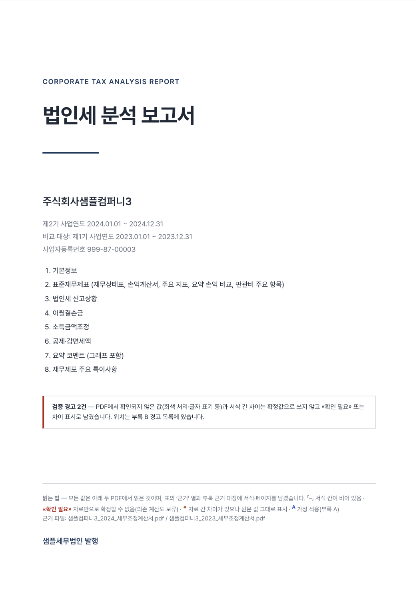
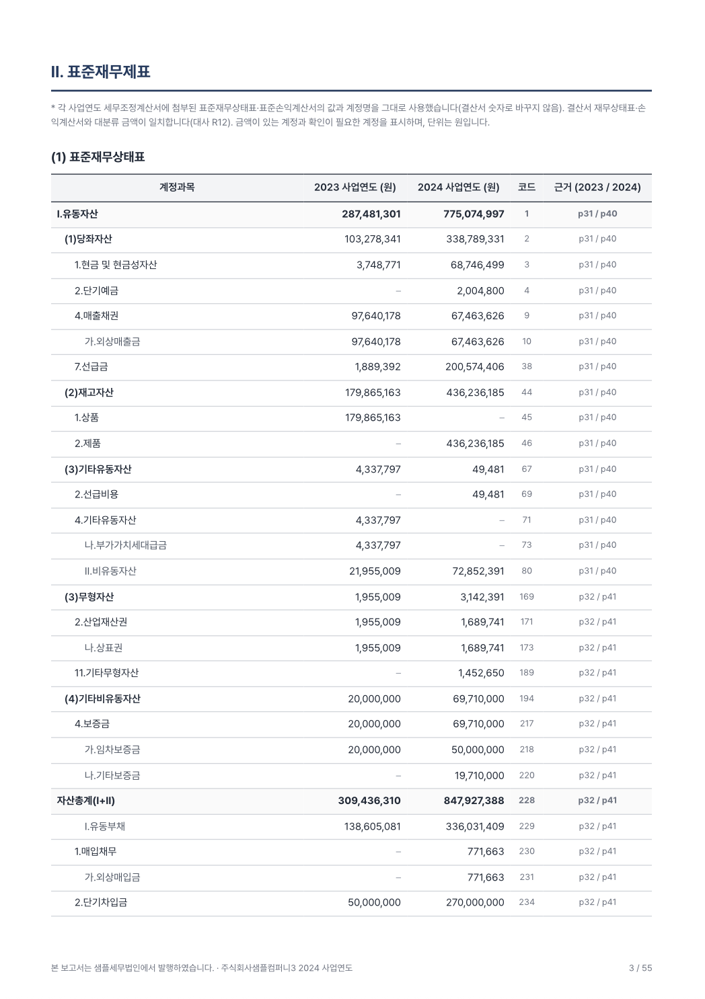
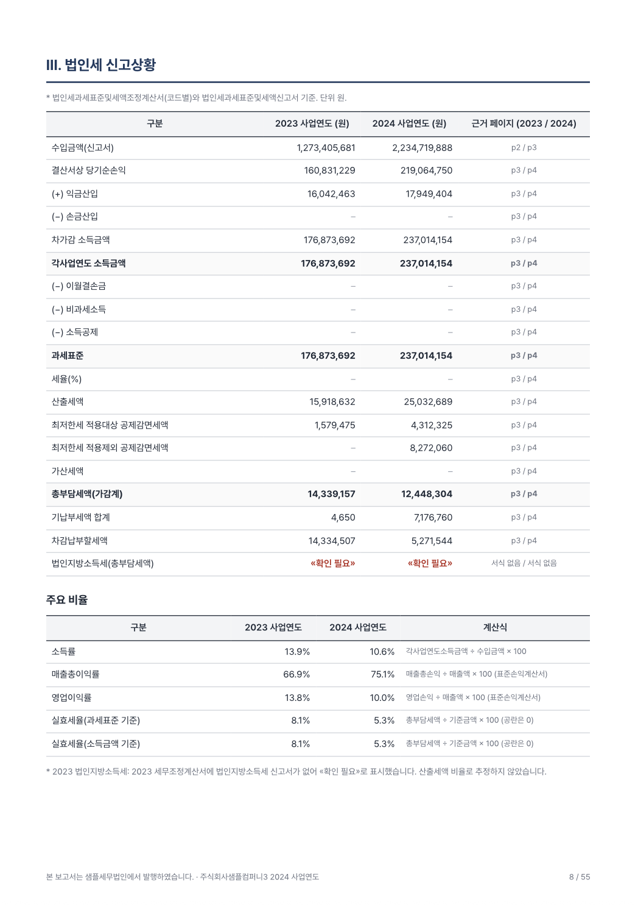
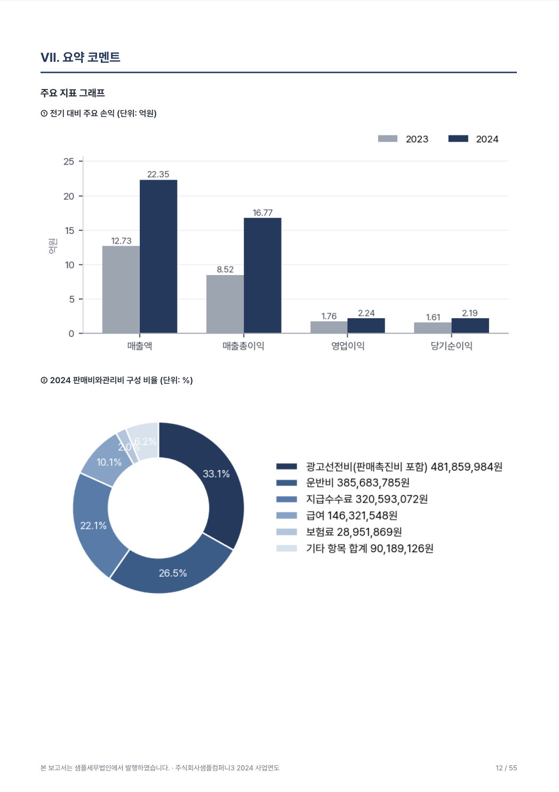
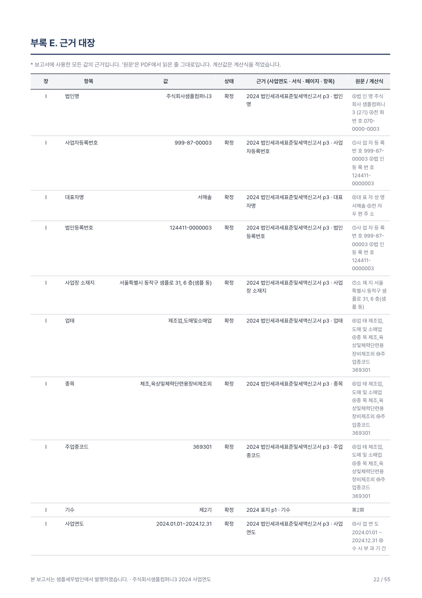

# 법인세 분석 보고서 자동화

같은 회사의 **전기·당기 세무조정계산서 PDF 2개**를 넣으면, 세무법인이 고객에게 보낼 **법인세 분석 보고서(PDF)** 와 **조정료청구서**를 만드는 프로그램입니다.

보고서의 모든 숫자에는 **어느 PDF의 어느 서식, 몇 쪽에서 왔는지** 근거가 붙습니다. 확정할 수 없는 값은 «확인 필요»로 표시하고 사실처럼 쓰지 않습니다.

> 자료에서 특이점이나 불명확한 부분이 보이면 세무법인 법인세 담당자에게 직접 질문하고, 받은 답변을 반영하며 진행했습니다(질문 23건, [질문 이력](doc/06_질문관리.md)).
>
> 4차수로 진행된 자동 채점 과제였고, **1~4차 모두 통과**했습니다. 차수마다 새 회사 자료를 받아 같은 프로그램을 계속 고쳐 썼습니다.

---

## 한눈에 보기

| | |
|---|---|
| **입력** | 세무조정계산서 PDF 2개 (전기·당기, 텍스트 PDF) |
| **출력** | 법인세 분석 보고서 PDF · 조정료청구서 PDF · 경고 목록 CSV + 경고 위치 캡처 · 근거 대장 JSON |
| **핵심 원칙** | 값마다 근거 / 확정되지 않은 값은 사실처럼 쓰지 않음 / 서식끼리 맞춰 봄 / 회사별 정답을 코드에 넣지 않음 |
| **기술** | Python 3.11, pdfplumber(글자 좌표·도형), Jinja2, matplotlib, 헤드리스 Chrome(HTML→PDF) |
| **결과** | 1차 통과 · 2차 12개 중 10개 · 3차 12개 중 12개 · 4차 통과 |
| **최종 보고서** | [`results/`](results/) |

<table>
  <tr>
    <td align="center"></td>
    <td align="center"></td>
    <td align="center"></td>
    <td align="center"></td>
    <td align="center"></td>
  </tr>
  <tr>
    <td align="center"><sub>표지 · 검증 경고 요약</sub></td>
    <td align="center"><sub>표준재무상태표 · 연도별 근거 페이지</sub></td>
    <td align="center"><sub>법인세 신고상황 · «확인 필요» 표시</sub></td>
    <td align="center"><sub>요약 코멘트 그래프</sub></td>
    <td align="center"><sub>부록 근거 대장 · PDF 원문</sub></td>
  </tr>
</table>
<p align="center"><sub>4차 보고서(샘플컴퍼니3, 2023→2024) 일부. 전체는 <a href="results/">results/</a>에 있습니다.</sub></p>

---

## 1. 문제

세무조정계산서는 수십 쪽짜리 국세청 서식 묶음입니다(신고서, 세액조정계산서, 표준재무제표, 자본금과적립금조정명세서, 공제감면세액합계표, 결산부속명세서 등). 여기서 숫자를 옮겨 보고서를 만드는 일은 단순해 보이지만, 실제로는 이런 함정이 있었습니다.

- **같은 서식이라도 회계 프로그램마다 PDF 모양이 다릅니다.** 쪽 전체가 밀려 있거나, 코드가 괄호에 붙거나(`)16`), 한 글자씩 나뉘거나(`2` `3`), 금액과 글자가 붙어 있습니다(`163,718,790II.비유동자산`).
- **"보이지 않는 값"이 있습니다.** 회색으로 가린 칸, 숫자 대신 「확인중」이라고 쓴 칸, 하위 항목이 가려져 비어 있는 합계 칸. 이것들을 0으로 읽으면 보고서가 조용히 틀립니다.
- **"보이는데 틀린 값"도 있습니다.** 매출원가 칸에 매출액이 그대로 찍혀 있는 식입니다.
- **이름이 같아도 의미가 다릅니다.** 공제감면 서식의 숫자가 '공제세액'이 아니라 '당기발생액'이거나, 가수금이 '기타유동부채'로 분류돼 있습니다.
- **서식끼리 숫자가 다릅니다.** 이월결손금 129,800원, 법인세등 209원, 자본금 차이 등이 있었습니다. 어느 쪽이 맞는지는 프로그램이 판단할 수 없습니다.
- **요구사항이 다 정해져 있지 않습니다.** 정해지지 않은 부분은 세무법인 담당자(역할극)에게 질문해서 받아야 했고, 답이 "아직 정해진 게 없어요"인 경우도 많았습니다.

## 2. 해결 방식

### 처리 흐름

```
PDF 2개 ─▶ ① 페이지·서식 식별      제목 규칙·정규식, 이어지는 쪽 상속, 회색 가림 도형 감지
        ─▶ ② 서식별 추출          칸마다 숫자 / 글자 표기 / 가림 / 빈칸 구분, 머리글 기준 좌표
        ─▶ ③ 회사·연도 확인        사업자번호 일치, 연속 사업연도
        ─▶ ④ 대사·검산            서식 간 대사 + 서식 안 검산 (규칙 R01~R18)
        ─▶ ⑤ 계산·코멘트          확정값으로만 계산하고, 입력이 미확정이면 그 계산만 보류
        ─▶ ⑥ 경고 묶기            원인 단위로 묶고, 보류된 계산을 영향으로 붙임
        ─▶ ⑦ 출력                보고서·청구서 PDF, 경고 CSV·캡처, 근거 대장
```

### 핵심 설계

**1. 모든 값은 근거를 가진 객체입니다.**
숫자 하나하나가 `Value(값, 상태, 플래그, 계산식)` + `Evidence(파일, 서식, 페이지, 항목 코드, PDF 원문 줄, 좌표)`로 다뤄집니다. 상태는 `확정 / 계산 / 가정 / 확인 필요 / 충돌` 중 하나입니다. 보고서 표마다 근거 열이 붙고, 부록에 근거 대장 전체가 실립니다.

**2. 칸을 4가지로 구분합니다.**

| PDF에 보이는 것 | 처리 |
|---|---|
| 숫자 | 확정 |
| 숫자 대신 글자 (「확인중」) | «확인 필요» · `글자표기` |
| 회색 가림 도형과 겹침 | «확인 필요» · `가림` (0으로 보지 않음) |
| 비어 있음 | 공란(0)이지만, 하위 항목이 가려진 합계 칸이면 «확인 필요» · `합계빈칸` |

가림 칸은 pdfplumber로 PDF의 **회색 채움 곡선 도형**을 찾아 칸 좌표와 겹치는지 보고 판정합니다.

**3. 보류는 필요한 만큼만 퍼집니다.**
`calc()`는 입력 중 하나라도 «확인 필요»면 결과도 보류하고 사유를 남깁니다. 매출액이 가려졌다면 매출 증감률과 비율 지표만 보류되고, 영업이익이나 판관비처럼 근거가 있는 숫자는 그대로 나옵니다.

**4. 좌표는 고정값이 아니라 서식의 머리글을 기준으로 잡습니다.**
「코드」 머리글, 세액조정계산서의 「01」「29」 코드 위치, 공제감면 서식의 열 머리글(③대상세액 ④감면세액 ⑤전기이월액 ⑥당기발생액 ⑦공제세액)을 기준으로 열과 숫자의 의미를 정합니다. 그래서 다른 회계 프로그램의 PDF에서도 같은 규칙이 동작합니다.

**5. 서식끼리 맞춰 보되, 고치지 않습니다.**
같은 항목이 여러 서식에 나오면 대사합니다. 다르면 먼저 같은 범위의 값인지 확인합니다(예: 수입금액 = 매출액 + 외환차익 + 이자수익이면 '설명된 차이'). 그래도 다르면 **어느 쪽이 맞는지 판단하지 않고** 경고로 남깁니다. 보고서의 재무 숫자는 담당자 답변에 따라 표준재무제표 값을 씁니다.

**6. 질문 기록부와 가정**
요구사항 공백은 담당자 질문으로 해결했습니다. 질문 형식은 «질문 / 필요한 이유 / 관련 파일·페이지 / 답에 따라 달라지는 구현»입니다. 답변은 `답변 있음 / 불명확·충돌 / 답변 없음`으로 분류하고, 답이 없는 항목은 가정(A-xxx)으로 진행해 보고서 부록에 드러냅니다. 최종 질문 23건의 분류는 답변 있음 7 · 불명확·충돌 3 · 답변 없음 13입니다.

## 3. 차수별 과정과 결과

| 차수 | 과제 | 마주친 문제 | 해결 → 프로그램에 남긴 것 | 결과 |
|---|---|---|---|---|
| **1차** | 요구사항 파악·첫 버전 | 요구사항 문서와 출력 예시의 목차가 다름. 판관비 선정 기준 등 미정 항목이 많음 | 담당자 질문 체계를 만들고, 목차 Ⅰ~Ⅷ을 확정. 답이 없는 항목은 가정으로 진행하고 부록에 공개 | **통과** |
| **2차** | 새 회사 자료 검증 | 1차 프로그램이 **실행 자체에 실패**(쪽이 27pt 밀린 PDF). 회색 가림·「확인중」 칸. 원본의 **보이는데 틀린 값**(매출원가 = 매출액) | 머리글 기준 좌표. 칸 4상태 구분. 계산 보류 전파. 경고 59건 → 원인 단위 21건. 서식 안 검산 규칙 R17 추가. 담당자에게 재송부를 요청 | **12개 중 10개** |
| **3차** | 입력 포맷 확장 | 다른 회계 프로그램 포맷(띄어쓰기, 붙은 코드, 결산서 없음). '공제세액'처럼 보이던 숫자가 실제로는 **당기발생액** | 열 머리글로 숫자의 의미를 결정. 서식이 없으면 같은 의미의 다른 서식으로 확인. 가지급금은 인정이자조정명세서로 확인 | **12개 중 12개** |
| **4차** | 재사용 검증 | 가수금이 '기타유동부채'로 분류됨. 코드가 한 글자씩 나뉨. '판관비 주요 항목' 채점 불일치 2회 | 금액 일치 계정 원칙. 나뉜 코드 처리. 채점 불일치의 원인은 **값이 아니라 표기**였음 → 표기 규칙 고정(아래) | **통과** |

### 4차에서 배운 것: 숫자가 맞아도 틀릴 수 있다

4차에서 '판관비 주요 항목'이 두 번 연속 불일치로 나왔습니다. 값을 다시 확인해 보니 숫자는 맞았고, 원인은 보고서를 **읽는 쪽**에 있었습니다.

1. 숫자가 PDF 텍스트로 추출되지 않았습니다. CSS `font-variant-numeric: tabular-nums` 때문에 화면에는 보이지만 텍스트로는 깨졌습니다.
2. 표마다 연도 열 순서가 달랐습니다(전기→당기 / 당기→전기 혼재).
3. 섹션·항목 이름이 채점 항목 이름(「판관비 주요 항목」, 「급여 총액」)과 달랐습니다.

세 가지를 모두 고치고 나서 통과했습니다. 그 뒤로는 출력을 **화면과 텍스트 추출 양쪽으로** 확인하고 있습니다.

### 회귀 확인

규칙을 고칠 때마다 이전 차수의 정상 자료를 모두 다시 실행했습니다. 그리고 근거 대장 JSON끼리 **같은 근거 위치·키의 값과 상태**를 비교했습니다. 4차 최종 프로그램 기준으로 1~3차 자료의 **값 차이는 0건**입니다. 실행 결과는 매번 새 폴더에 저장해서 덮어쓰지 않았습니다.

## 4. 결과물

[`results/`](results/)에는 차수별로 제출해 통과한 최종 보고서가 있습니다.

| 파일 | 회사·연도 |
|---|---|
| [1차_샘플컴퍼니_2025_법인세분석보고서.pdf](results/1차_샘플컴퍼니_2025_법인세분석보고서.pdf) | 샘플컴퍼니 2024→2025 |
| [2차_샘플컴퍼니2_2025_법인세분석보고서.pdf](results/2차_샘플컴퍼니2_2025_법인세분석보고서.pdf) | 샘플컴퍼니2 2024→2025 (재송부본) |
| [3차_샘플컴퍼니4_2024_법인세분석보고서.pdf](results/3차_샘플컴퍼니4_2024_법인세분석보고서.pdf) | 샘플컴퍼니4 2023→2024 |
| [4차_샘플컴퍼니3_2024_법인세분석보고서.pdf](results/4차_샘플컴퍼니3_2024_법인세분석보고서.pdf) | 샘플컴퍼니3 2023→2024 |

모든 회사·숫자는 과제용 가상 샘플 데이터입니다.

**보고서 구성**

- **표지**
- **Ⅰ 기본정보**
- **Ⅱ 재무제표**: 표준재무상태표, 표준손익계산서, 주요 지표 비교, 요약 손익 비교, 판관비 주요 항목
- **Ⅲ 법인세 신고상황**
- **Ⅳ 이월결손금**
- **Ⅴ 소득금액조정**
- **Ⅵ 공제·감면세액**
- **Ⅶ 요약 코멘트**: 그래프 4종
- **Ⅷ 재무제표 주요 특이사항**: 매출처, 가수금, 가지급금, 판관비 계정 변동, 자본잠식
- **부록 A~E**: 가정, 검증 경고, 대사 결과, 질문 기록, 근거 대장

## 5. 실행 방법

```bash
pip install -r requirements.txt

PYTHONPATH=src python3 -m taxreport \
  --prior   <전기_세무조정계산서.pdf> \
  --current <당기_세무조정계산서.pdf> \
  --out     out/<실행 이름>
```

- 결과는 `out/<실행 이름>/<회사>_<당기>_<실행시각>/`에 새로 만들어집니다.
- 같은 회사의 연속된 두 사업연도가 아니면 실행을 멈춥니다.
- PDF 변환에는 Google Chrome(헤드리스)이 필요합니다. 폰트는 Pretendard를 쓰고, 없으면 Apple SD Gothic Neo를 씁니다.
- `tests/`는 과제 입력 PDF를 기준으로 한 기대값 테스트입니다. 입력 자료(`tax/`)는 저장소에 포함하지 않았기 때문에, 저장소만 받아서는 테스트를 실행할 수 없습니다.

## 6. 코드 구조

```
src/taxreport/
├── pdfsrc.py     글자 좌표 읽기, 붙은 토큰 분리, 서식 식별, 회색 가림 도형 감지
├── extract.py    서식별 추출기 (공통 cell(): 숫자/글자/가림/빈칸 판정, 체크 표시 ○ 판독)
├── models.py     Evidence · Value
├── build.py      회사·연도 확인, 대사·검산 R01~R18, 장별 내용, 계산 보류, 경고 묶기
├── charts.py     그래프 4종 (확정값만 그림)
├── fee.py        조정료 계산 (보수표 8구간)
├── render.py     값 표시 규칙, HTML → PDF
└── templates/    보고서·청구서 레이아웃 (Jinja2)
config/
├── firm.yaml           발행 법인, 판관비 주요 항목 개수
├── fee_schedule.yaml   조정료 보수표
└── questions.yaml      질문 기록부·가정 목록 (보고서 부록 A·D의 원본)
```

## 7. 남은 한계

| 항목 | 현재 처리 |
|---|---|
| 서식 간 숫자 차이 | 어느 쪽이 맞는지 판단하지 않고 차이로 표시하며, 사람의 확인을 기다림 |
| 보이는데 틀린 값 | 서식 안 검산(R17)으로 일부만 잡힘. 검산할 상대 값이 가려져 있으면 잡지 못함 |
| 법인지방소득세 신고서가 없는 연도 | «확인 필요» |
| 자본잠식 해소 필요액, 조정료 가산보수·부가세 | 기준이 정해지지 않아 «확인 필요» |
| 새 포맷 | 서식 형식 기반 규칙이라, 처음 보는 회계 프로그램의 출력은 다시 점검이 필요함 |

## 8. 문서

설계와 진행 기록은 [`doc/`](doc/)에 있습니다. [00_개요_및_계획](doc/00_개요_및_계획.md)에서 시작하면 됩니다.

| 문서 | 내용 |
|---|---|
| [02_데이터모델_근거추적](doc/02_데이터모델_근거추적.md) | Value·Evidence·상태·플래그 |
| [03_추출_검증_로직](doc/03_추출_검증_로직.md) | 서식 식별, 칸 판정, 포맷 차이 대응, 대사 규칙 |
| [04_보고서_설계](doc/04_보고서_설계.md) | 보고서 구성, 표기 규칙, 계산식 |
| [06_질문관리](doc/06_질문관리.md) | 담당자 질문 23건의 전체 이력 |
| [09](doc/09_2차_새회사검증.md) · [10](doc/10_3차_입력포맷확장.md) · [11](doc/11_4차_재사용검증.md) | 2·3·4차 실행·수정·회귀 기록 |
| [12_최종_회고](doc/12_최종_회고.md) | 차수별로 배운 것, 실수, 남은 한계 |

`doc/` 안의 `out/…` 경로는 작업 당시의 실행 폴더입니다. 공개 저장소에는 `results/`의 최종 보고서만 포함했습니다.
